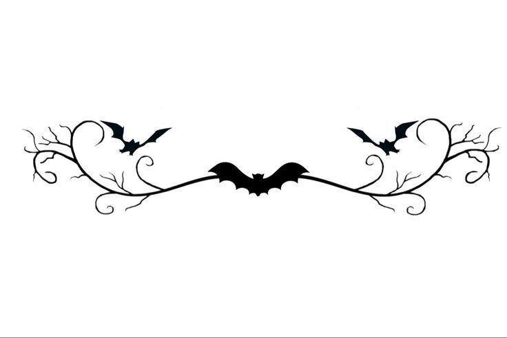

<!-- Banner principal -->

  

<!-- Titulo -->

  

---

**Desenvolvedora Front-End/ Designer Gráfica**

> *Atualmente, estou aprofundando meus estudos em **Python**, **SQL** e **JavaScript**.*

Tenho experiência com **HTML5**, **CSS3**, **JavaScript**, **Git** , **Python** e **React**.

 

ⓘ  Origin — Brazil 

---

## Linguagens e Apps

---

---
##

---

---

<!-- Alguma mensagem aleatória para dar mais composição -->
*♰ "A paz jamais será conquistada através da violência." ♰*

